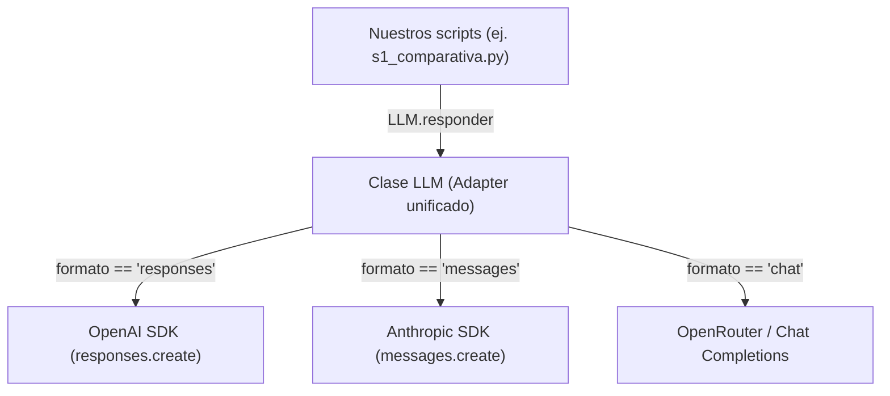

# Guía Maestra de Estudio: Sesión 1 - Integración con LLMs
> **Asignatura:** Máster en IA · Bloque 4  
> **Caso Práctico:** Tostadero Retiro S.L.  
> **Preparación para la defensa oral individual con el profesor**

---

## 📌 Tabla de Contenidos
1. [Diccionario básico: Conceptos de IA para personas normales](#1-diccionario-básico-conceptos-de-ia-para-personas-normales)
2. [El caso de negocio: Tostadero Retiro S.L.](#2-el-caso-de-negocio-tostadero-retiro-sl)
3. [El punto de partida: ¿Qué nos dio el profesor?](#3-el-punto-de-partida-qué-nos-dio-el-profesor)
4. [Paso a paso de lo que hicimos (P1 a P5)](#4-paso-a-paso-de-lo-que-hicimos-p1-a-p5)
5. [La joya técnica: El patrón Adapter en `llm_client.py`](#5-la-joya-técnica-el-patrón-adapter-en-llm_clientpy)
6. [El gran misterio: ¿Por qué Gemini gastó 500 tokens de salida?](#6-el-gran-misterio-por-qué-gemini-gastó-500-tokens-de-salida)
7. [La decisión económica: ¿Qué modelo elegimos y por qué?](#7-la-decisión-económica-qué-modelo-elegimos-y-por-qué)
8. [Simulacro de examen: Preguntas que te va a hacer el profesor y cómo responder](#8-simulacro-de-examen-preguntas-que-te-va-a-hacer-el-profesor-y-cómo-responder)

---

## 1. Diccionario básico: Conceptos de IA para personas normales

Para poder defender tu trabajo con soltura, necesitas dominar el vocabulario. Olvídate de definiciones matemáticas complejas; aquí tienes la explicación sencilla y real de cada término:

* **LLM (*Large Language Model* o Gran Modelo de Lenguaje):**  
  Es el "cerebro" de IA (como GPT, Claude o Gemini). No razona como un humano; lo que hace es predecir matemáticamente cuál es la siguiente palabra más probable basándose en miles de millones de textos con los que ha sido entrenado.

* **API (*Application Programming Interface*):**  
  Es la "puerta de comunicación" por internet. En lugar de que tú abras la web de ChatGPT y escribas, tu código de Python envía un mensaje a los servidores de OpenAI y recibe la respuesta automáticamente a través de la API.

* **SDK (*Software Development Kit*):**  
  Es la librería oficial en Python que nos da cada empresa (por ejemplo, la librería `openai` o `anthropic`) para facilitarnos hablar con su API sin tener que programar peticiones web desde cero.

* **OpenRouter:**  
  Es una "pasarela intermediaria". En lugar de tener que contratar y meter una tarjeta de crédito en OpenAI, otra en Anthropic y otra en Google, te creas una sola cuenta en OpenRouter, recargas 5€ y te da acceso a **todos los modelos** del mercado con una sola clave.

* **Token:**  
  Los modelos no leen palabras completas, leen "trocitos de palabras" llamados tokens.  
  *Regla general:* En inglés, 1 palabra ≈ 1 token. En español, debido a las tildes y terminaciones, 1 palabra suele ocupar **1,3 a 1,8 tokens**.  
  - **Tokens de entrada (*prompt tokens*):** Los que tú le envías al modelo (instrucciones + correo).
  - **Tokens de salida (*completion tokens*):** Los que el modelo genera para contestarte.  
  *Importante:* Las empresas de IA te cobran por cada token (por millón de tokens).

* **System Prompt (*Mensaje de Sistema*):**  
  Son las instrucciones que definen la "personalidad", las normas y los límites del asistente antes de que lea la consulta del usuario. En nuestro caso: *"Eres el asistente de Tostadero Retiro... responde en máximo 2 frases"*.

* **User Prompt (*Mensaje de Usuario*):**  
  El texto específico que queremos procesar (en nuestro caso, el correo que envió Marta o el hotel).

* **Temperatura (`temperature`):**  
  Controla la "creatividad" o aleatoriedad de la respuesta (va de 0.0 a 1.0 o 2.0 según el modelo):
  - `0.0`: El modelo siempre elige la palabra más probable. Respuestas idénticas y predecibles (ideal para clasificación y tareas técnicas).
  - `0.7 - 1.0`: Respuestas variadas y creativas.

* **Latencia:**  
  El tiempo en segundos que tarda el modelo en procesar tu petición y devolverte la respuesta.

* **Streaming:**  
  En lugar de esperar 4 segundos a que el modelo escriba toda la frase y te la dé de golpe, el servidor te va mandando cada palabra en cuanto la genera (como cuando ves a ChatGPT escribir en tiempo real).

* **Thinking Tokens (*Tokens de razonamiento*):**  
  Modelos avanzados (como Gemini 3.8 Flash o OpenAI o1) tienen una fase interna donde "piensan" antes de escribir. Ese monólogo interior no te lo muestran, pero **cuenta como tokens de salida y te lo cobran**.

---

## 2. El caso de negocio: Tostadero Retiro S.L.

Todo el Bloque 4 se basa en una empresa ficticia: **Tostadero Retiro S.L.**, una empresa que tuesta café y distribuye cafeteras e insumos a bares, hoteles y particulares.

### El problema:
La empresa recibe decenas de correos al día:
- Averías (la cafetera pierde presión o gotea).
- Pedidos (quieren 15 kg de café para el jueves).
- Dudas de facturas (por qué septiembre es más caro).
- Nuevos clientes (un hotel pidiendo recomendación de café).

### La solución requerida:
Crear un sistema de IA capaz de clasificar y contestar rápidamente a los correos bajo dos reglas estrictas de atención al cliente:
1. Responder en **español**.
2. Responder en **dos frases como máximo**.

---

## 3. El punto de partida: ¿Qué nos dio el profesor?

El profesor proporcionó un archivo comprimido (`master-ia-bloque4-main.zip`) con la siguiente base:

1. **`requirements.txt`:** Lista de librerías necesarias de Python (`openai`, `anthropic`, `google-genai`, `python-dotenv`, etc.).
2. **`crear_bd.py`:** Un script que genera una base de datos local SQLite (`tostadero.db`) con clientes, productos y pedidos simulados.
3. **`.env.example`:** Una plantilla que explica qué claves de API necesitamos.
4. **Carpetas `Sesion-1/P1` a `P5`:** Carpetas con el código esqueleto y los enunciados en `README.md`.

### Sobre tu carpeta de trabajo y el archivo `.env`:
- Creamos un entorno virtual aislado (**`.venv`**) para que las librerías no choquen con otros programas de tu ordenador.
- Creamos un archivo **`.env`** donde pegaste tu clave de OpenRouter (`OPENROUTER_API_KEY=sk-or-v1-...`).  
  > ⚠️ **Pregunta típica del profesor:** *¿Por qué `.env` no está en tu GitHub?*  
  > **Tu respuesta:** *"Porque el archivo `.env` contiene mis claves secretas de pago. Si lo subo a GitHub, cualquiera podría robarme saldo o la cuenta sería bloqueada por seguridad. Está protegido dentro del archivo `.gitignore` para que Git nunca lo suba al repositorio público."*

---

## 4. Paso a paso de lo que hicimos (P1 a P5)

### P1. Entorno (Comprobación inicial)
- **Objetivo:** Verificar que el entorno virtual `.venv` y las claves en `.env` estaban bien configuradas.
- **Acción:** Copiamos los scripts principales a la carpeta raíz para que pudieran comunicarse entre ellos sin errores de rutas.

---

### P2. El mismo encargo a tres proveedores (`s1_hola_tres.py`)
- **Objetivo:** Enviar el mismo correo de prueba ("la cafetera gotea y tengo pendiente el pedido 1004") a tres proveedores distintos (OpenAI, Claude y Gemini) para ver cómo responde cada uno por separado.
- **Qué descubrimos:**
  1. **Velocidad:** OpenAI y Claude fueron rapidísimos (~2 segundos), mientras que Gemini tardó más de 5 a 7 segundos.
  2. **Tokens de entrada diferentes:** Para el mismo texto, OpenAI usó 93 tokens, Claude 131 y Gemini 85. Esto ocurre porque cada empresa inventó su propio **tokenizador** con vocabularios de distinto tamaño.
  3. **Clasificación:** Los tres acertaron clasificando el correo como **"mixto"** (incidencia técnica + consulta sobre pedido).
  4. **Variación:** Al ejecutarlo dos veces, la redacción cambió ligeramente porque la temperatura por defecto es mayor a cero.

---

### P3. Una interfaz común (`llm_client.py`) — *Parte del Entregable E1*
- **Objetivo:** En P2 teníamos que escribir código completamente distinto para OpenAI, para Claude y para Gemini. En P3 programamos un **adaptador único**: una sola clase `LLM` con un método `responder()` para que el resto de nuestros programas no tengan que preocuparse de qué API hay por debajo.
- **Lo que programamos:**
  1. **Rama de OpenAI (`responses`):** Conectamos con `client.responses.create(...)` y leímos `output_text` y sus tokens.
  2. **Rama de Claude (`messages`):** Conectamos con `client.messages.create(...)`. Tuvimos en cuenta que Claude exige obligatoriamente indicarle un límite de salida (`max_tokens`) y que devuelve el texto en bloques.
  3. **Diccionario de precios (`PRECIOS`):** Introdujimos los precios en dólares por millón de tokens consultados en OpenRouter.
  4. **Parámetro `max_tokens`:** Permitimos limitar la longitud de salida adaptando el nombre que usa cada SDK (`max_output_tokens` en OpenAI/Gemini frente a `max_tokens` en Claude).

---

### P4. Comparativa de proveedores (`s1_comparativa.py`) — *Parte del Entregable E1*
- **Objetivo:** Probar los 3 modelos con 5 correos reales diferentes (15 llamadas en total), medir sus tiempos y costes, evaluar la calidad de las respuestas humanas y volcarlo todo a un archivo CSV.
- **Lo que hicimos:**
  1. Programamos el bucle que llama a `LLM(proveedor).responder(SISTEMA, correo)`.
  2. Generamos el archivo `comparativa.csv`.
  3. Evaluamos humanamente cada respuesta del 1 al 5 en la columna `calidad_1a5`.
  4. Redactamos el documento `analisis.md` con las conclusiones.

---

### P5. Streaming (`s1_streaming.py`) — *Opcional*
- **Objetivo:** Demostrar cómo funciona la recepción de respuestas trozo a trozo (*streaming* de tokens).
- **Qué aporta:** Mejora la experiencia del usuario (Time To First Token), haciendo que la aplicación parezca instantánea.

---

## 5. La joya técnica: El patrón Adapter en `llm_client.py`

Esta es la parte de código más importante de tu entrega. Si el profesor te pide abrir `llm_client.py` y explicarlo, esto es lo que debes tener claro:

### ¿Qué es el Patrón Adapter (Adaptador)?
Imagina que viajas al extranjero con un cargador de España: en Reino Unido el enchufe tiene 3 clavijas planas y en EE.UU. tiene dos patillas rectas. En lugar de comprar 3 cargadores nuevos, compras un **adaptador universal**.  
`llm_client.py` es exactamente ese adaptador:
- Por fuera, ofrece siempre la misma función: `llm.responder(sistema, prompt)`.
- Por dentro, sabe cómo "enchufarse" a OpenAI, a Claude o a Gemini traduciendo las peticiones al formato exacto que exige cada uno.

### Diferencias técnicas clave entre los 3 proveedores:
| Característica | OpenAI (`responses`) | Claude (`messages`) | Gemini (vía OpenRouter / `chat`) |
| :--- | :--- | :--- | :--- |
| **Método de llamada** | `_c.responses.create(...)` | `_c.messages.create(...)` | `_c.chat.completions.create(...)` |
| **Instrucción de sistema** | Parámetro `instructions=...` | Parámetro `system=...` | Mensaje con `{"role": "system"}` |
| **Parámetro de tokens** | `max_output_tokens` | `max_tokens` *(obligatorio)* | `max_tokens` |
| **Cómo devuelve el texto** | `r.output_text` | Lista de bloques: `"".join(...)` | `r.choices[0].message.content` |
| **Conteo de tokens** | `r.usage.input_tokens` | `r.usage.input_tokens` | `r.usage.prompt_tokens` |

---

## 6. El gran misterio: ¿Por qué Gemini gastó 500 tokens de salida?

Al mirar la tabla de `comparativa.csv`, cualquier profesor se fijará en este detalle:
- Para el correo de la cafetera, OpenAI usó **75 tokens de salida**.
- Claude usó **76 tokens de salida**.
- ¡Gemini usó **539 tokens de salida**!

Si las tres respuestas finales son igual de cortas (dos frases), **¿por qué Gemini gastó 7 veces más tokens?**

### La explicación técnica:
El modelo configurado es `google/gemini-3.8-flash`. Este modelo en OpenRouter tiene activado por defecto el **razonamiento interno (*thinking / chain-of-thought tokens*)**.  
Antes de escribir la respuesta visible, el modelo genera mentalmente un monólogo de reflexión:
> *(“El cliente dice que gotea por el grupo 1. Las cafeteras espresso industriales de hostelería tienen junta de estanqueidad, ducha y portafiltro. Debe ser la junta. Debo responder como Tostadero Retiro, en español y en máximo 2 frases...”)*

Ese monólogo interno no nos lo muestra en la respuesta final para no marear al usuario, pero **la API lo computa y lo cobra como tokens de salida**. Por eso, aunque el texto final tenga 50 palabras, la API facturó más de 500 tokens.

> 💡 **La prueba de `max_tokens=20`:**  
> En P3, cuando probamos `max_tokens=20`, si un modelo con razonamiento se queda con texto vacío, es precisamente por esto: agota los 20 tokens en empezar a pensar y se le acaba el límite antes de poder escribir la primera palabra.

---

## 7. La decisión económica: ¿Qué modelo elegimos y por qué?

En la P4 el profesor te pregunta:  
*«¿Qué modelo elegiríais para contestar 2.000 correos al mes en Tostadero Retiro S.L. y por qué? Apóyate en los datos de la tabla.»*

### Los datos reales que obtuvimos:
| Modelo | Latencia media | Coste medio / correo | Coste 2.000 correos al mes | Calidad humana |
| :--- | :---: | :---: | :---: | :---: |
| **`openai/gpt-5.4-mini`** | **1.62 segundos** | **$0.000282** | **$0.56 / mes** | **5.0 / 5** |
| **`anthropic/claude-haiku-4.5`** | 5.45 segundos | $0.000456 | $0.91 / mes | 4.6 / 5 |
| **`google/gemini-3.8-flash`** | 6.56 segundos | $0.002105 | $4.21 / mes | 5.0 / 5 |

### La respuesta que debes dar:
Elegimos rotundamente **OpenAI (`gpt-5.4-mini`)** por tres razones objetivas:
1. **Velocidad (Latencia):** Es más de **3 veces más rápido** que Claude y 4 veces más rápido que Gemini. Tarda solo 1.6 segundos en responder. En atención al cliente, la inmediatez es vital.
2. **Coste imbatible:** Contestar 2.000 correos nos cuesta solo **56 céntimos de dólar al mes**. Gemini costaría más de 4 dólares al mes (7 veces más caro) por culpa del derroche de tokens de pensamiento innecesarios para esta tarea.
3. **Calidad y cumplimiento estricto:** Logró la máxima puntuación (5/5), respetando siempre la regla de dos frases y aportando soluciones prácticas (ofreciendo revisar facturas, enviar técnicos o tomar nota del pedido).

---

## 8. Simulacro de examen: Preguntas que te va a hacer el profesor y cómo responder

Aquí tienes las preguntas clave que te puede hacer el profesor frente a su ordenador, con la respuesta natural que debes dar:

---

### ❓ Pregunta 1: "¿Por qué creaste `llm_client.py` en vez de llamar a las APIs directamente?"
> **Tu respuesta:**  
> *"Porque en producción no conviene acoplar tu aplicación a un proveedor concreto. Aplicamos el patrón **Adapter**: creamos una interfaz única con el método `responder()` que oculta la complejidad interna de cada SDK. Así, si mañana queremos cambiar de OpenAI a Claude o a un modelo local en Ollama, solo cambiamos una línea en nuestro programa principal y todo sigue funcionando."*

---

### ❓ Pregunta 2: "¿Por qué en OpenAI pusiste `max_output_tokens` y en Claude `max_tokens`?"
> **Tu respuesta:**  
> *"Porque cada SDK oficial tiene su propia nomenclatura. La nueva Responses API de OpenAI llama al parámetro `max_output_tokens`, mientras que la Messages API de Anthropic lo llama `max_tokens`. Además, en Claude ese parámetro es estrictamente obligatorio, por lo que en el Adapter le pusimos un valor por defecto (1024) por si el usuario no especifica ninguno."*

---

### ❓ Pregunta 3: "¿Cómo calculas el coste en dólares de cada respuesta?"
> **Tu respuesta:**  
> *"En `llm_client.py` creamos el diccionario `PRECIOS` con los costes oficiales por millón de tokens sacados de OpenRouter: `(precio_entrada, precio_salida)`. Luego, en la clase `Respuesta`, tenemos la propiedad `coste_usd` que aplica la fórmula:*  
> `(tokens_entrada * precio_entrada + tokens_salida * precio_salida) / 1.000.000`  
> *Nos devuelve el coste exacto en dólares."*

---

### ❓ Pregunta 4: "Veo que en `comparativa.csv` Gemini gasta más de 500 tokens de salida y OpenAI solo 50. ¿Hay un bug en tu código?"
> **Tu respuesta:**  
> *"No, no es ningún bug. El código recoge exactamente lo que devuelve la API en `r.usage`. Lo que ocurre es que `gemini-3.8-flash` tiene activado el razonamiento interno (*thinking tokens*). El modelo genera cientos de tokens de monólogo interior antes de dar la respuesta visible. Esos tokens no aparecen en el texto final, pero la API los cobra y los computa en el uso de salida."*

---

### ❓ Pregunta 5: "¿Qué tienes en la carpeta `e1/` y por qué?"
> **Tu respuesta:**  
> *"En la carpeta `e1/` está el entregable oficial E1 que usted pidió:*  
> *1. `llm_client.py` con el Adapter terminado y los precios.*  
> *2. `comparativa.csv` con las 15 llamadas y las notas de calidad del 1 al 5.*  
> *3. `analisis.md` con el informe justificativo de costes, latencia y la elección del modelo para 2.000 correos."*

---

### ❓ Pregunta 6: "¿Dónde están tus claves de API? ¿Por qué no las veo en GitHub?"
> **Tu respuesta:**  
> *"Están guardadas en local en el archivo `.env`. Como contiene información sensible y claves que gastan dinero, ese archivo está incluido en `.gitignore` para que bajo ninguna circunstancia se suba al repositorio público de GitHub."*

---

### ❓ Pregunta 7: "¿Qué diferencia hay entre llamar a los modelos en modo normal y en streaming?"
> **Tu respuesta:**  
> *"En modo normal, la conexión espera hasta que el modelo termina de generar todo el texto y lo entrega completo de golpe. En streaming, la API utiliza Server-Sent Events (SSE) para enviar cada fragmento (*delta*) conforme se procesa. No reduce el tiempo total de generación, pero reduce drásticamente la latencia percibida por el usuario (*Time To First Token*)."*

