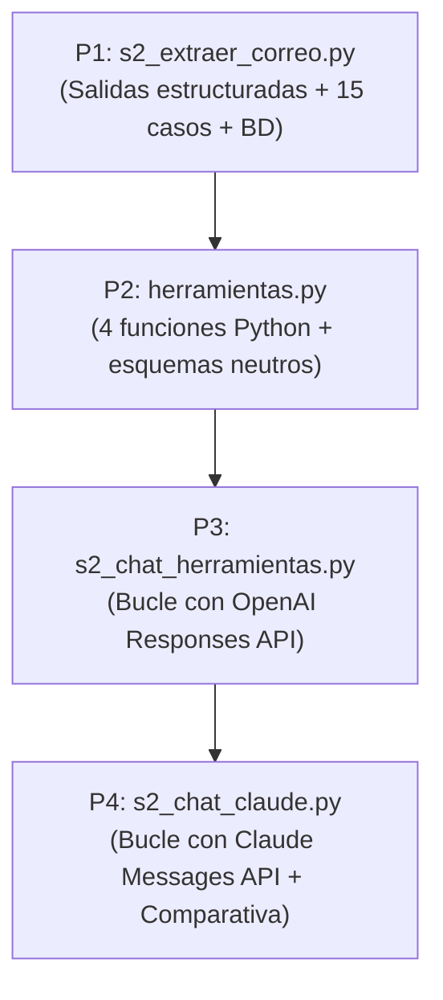
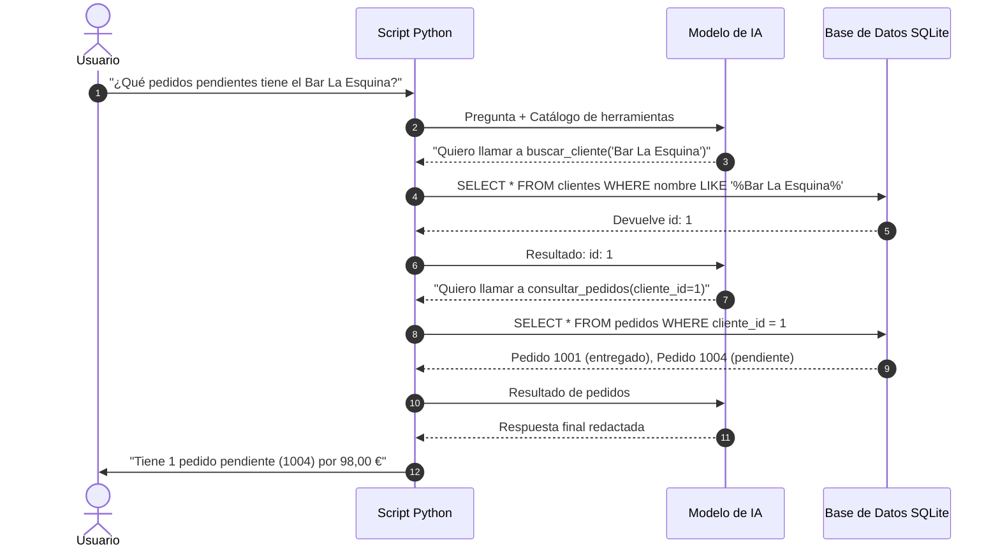

# Guía Maestra de Estudio: Sesión 2 - Salidas Estructuradas y Uso de Herramientas
> **Asignatura:** Máster en IA · Bloque 4  
> **Caso Práctico:** Tostadero Retiro S.L.  
> **Preparación para la defensa oral individual con el profesor (Entregable E2)**

---

## 📌 Tabla de Contenidos
1. [Diccionario básico de la Sesión 2: Conceptos sin tecnicismos](#1-diccionario-básico-de-la-sesión-2)
2. [El caso de negocio y la base de datos `tostadero.db`](#2-el-caso-de-negocio-y-la-base-de-datos)
3. [Recorrido paso a paso: De P1 a P4](#3-recorrido-paso-a-paso-de-p1-a-p4)
4. [La joya técnica 1: Salidas Estructuradas con Pydantic (`s2_extraer_correo.py`)](#4-la-joya-técnica-1-salidas-estructuradas-con-pydantic)
5. [La joya técnica 2: El Bucle de Herramientas (*Function Calling Loop*)](#5-la-joya-técnica-2-el-bucle-de-herramientas)
6. [Comparativa de Proveedores: OpenAI vs. Claude](#6-comparativa-de-proveedores-openai-vs-claude)
7. [Simulacro de examen: Las 7 preguntas del profesor y cómo responder](#7-simulacro-de-examen)

---

## 1. Diccionario básico de la Sesión 2

* **Salidas Estructuradas (*Structured Outputs*):**  
  Hasta la Sesión 1, la IA nos devolvía un párrafo de texto libre. Con las salidas estructuradas obligamos al modelo a devolver los datos encajados en un "molde" exacto de Python (un objeto con campos como `tipo`, `cliente`, `lineas`, `urgente`). Garantiza al 100% que la respuesta no contiene texto sobrante ni faltan campos.

* **Pydantic y `BaseModel`:**  
  Pydantic es la librería estándar de Python para validar datos. Creamos una clase que hereda de `BaseModel` para definir el esquema:
  ```python
  class CorreoClasificado(BaseModel):
      tipo: Literal["pedido", "incidencia", "consulta", "mixto"]
      cliente: str | None
      urgente: bool
  ```
  Si la IA intentara inventar un tipo que no sea uno de esos cuatro, Pydantic rechaza la respuesta por inválida.

* **Uso de herramientas (*Tool Calling / Function Calling*):**  
  Es la capacidad de un LLM de reconocer que no sabe un dato o que necesita realizar una acción, y pedirle a nuestro programa que ejecute una función de Python por él.

* **Por qué la IA no ejecuta código directamente:**  
  Por motivos críticos de **seguridad**. La IA nunca toca la base de datos ni ejecuta código en tu ordenador. La IA solo emite un mensaje diciendo: *"Oye, para responder necesito que ejecutes `buscar_cliente('La Esquina')`"*. Nuestro código en Python es quien ejecuta la función, lee SQLite y le devuelve los datos.

* **El bucle de herramientas (*Agent Loop*):**  
  Un proceso en varias vueltas:
  1. El usuario pregunta.
  2. La IA pide una o varias herramientas.
  3. Nuestro código ejecuta las herramientas y le entrega los resultados a la IA.
  4. La IA lee los resultados y, si tiene todo lo necesario, redacta la respuesta final.

---

## 2. El caso de negocio y la base de datos

En esta sesión el asistente de **Tostadero Retiro S.L.** deja de ser un simple bot conversacional y se convierte en un **agente conectado a los sistemas de la empresa**:

### La base de datos SQLite ([`tostadero.db`](file:///c:/Users/lauri/Desktop/master-ia-bloque4-rodriguez-laura/tostadero.db))
Contiene 4 tablas clave:
1. `clientes`: Id, nombre del negocio, tipo (bar, restaurante, hotel) y distrito de Madrid.
2. `pedidos`: Historial de pedidos con su fecha, estado (`pendiente`, `entregado`) y total en euros.
3. `productos`: Catálogo con SKU, nombre del café o máquina, precio y stock disponible.
4. `incidencias`: Registro de averías técnicas de máquinas de clientes.

---

## 3. Recorrido paso a paso: De P1 a P4



* **P1 (Clasificador con evaluación):** Creamos el extractor con Pydantic, ampliamos el banco de pruebas a 15 casos con dificultades reales y conectamos con la base de datos para avisar si el cliente no existe.
* **P2 (Herramientas en Python):** Leímos y comprendimos las 4 funciones de negocio (`buscar_cliente`, `consultar_pedidos`, `stock_producto`, `crear_incidencia`) y sus adaptadores para cada SDK.
* **P3 (Bucle de herramientas con OpenAI):** Ejecutamos el bucle sobre 4 preguntas complejas observando cómo encadena herramientas y cómo gestiona consultas vacías o acciones no permitidas.
* **P4 (Bucle con Claude y Comparativa):** Programamos el mismo bucle para el SDK de Anthropic (`s2_chat_claude.py`), ejecutamos las mismas 4 preguntas y comparamos métricas de tokens y llamadas.

---

## 4. La joya técnica 1: Salidas Estructuradas con Pydantic

En [`s2_extraer_correo.py`](file:///c:/Users/lauri/Desktop/master-ia-bloque4-rodriguez-laura/e2/s2_extraer_correo.py):
- En lugar de usar `create()`, usamos el método **`.parse()`**:
  - OpenAI: `client.responses.parse(..., text_format=CorreoClasificado)`
  - Claude: `client.messages.parse(..., output_format=CorreoClasificado)`
  - Gemini: `client.chat.completions.parse(..., response_format=CorreoClasificado)`
- La respuesta ya no es un texto plano: viene convertida directamente en un objeto de Python tipado (`r.output_parsed`).

### Las validaciones de negocio añadidas:
1. **Validación de cantidades:** Comprobamos que ninguna línea tenga cantidad $\le 0$.
2. **Validación en base de datos:** Si la IA detecta un cliente en el correo, llamamos a `buscar_cliente(resultado.cliente)`. Si la base de datos devuelve vacío, el programa avisa:
   > `Aviso: el cliente 'Restaurante Fantasma' no existe en la base de datos`

---

## 5. La joya técnica 2: El Bucle de Herramientas

En [`s2_chat_herramientas.py`](file:///c:/Users/lauri/Desktop/master-ia-bloque4-rodriguez-laura/s2_chat_herramientas.py) y [`s2_chat_claude.py`](file:///c:/Users/lauri/Desktop/master-ia-bloque4-rodriguez-laura/e2/s2_chat_claude.py):



---

## 6. Comparativa de Proveedores: OpenAI vs. Claude

| Pregunta evaluada | OpenAI (`gpt-5.4-mini`) | Claude (`claude-haiku-4.5`) | ¿Misma lógica? |
| :--- | :---: | :---: | :---: |
| **1. Pedidos pendientes Bar La Esquina** | 2 llamadas (in: 1.041 / out: 98) | 2 llamadas (in: 3.496 / out: 216) | ✅ Sí (`buscar_cliente` -> `consultar_pedidos`) |
| **2. Stock de descafeinado** | 1 llamada (in: 597 / out: 49) | 1 llamada (in: 2.153 / out: 109) | ✅ Sí (`stock_producto`) |
| **3. Bar Inexistente** | 1 llamada (in: 563 / out: 57) | 1 llamada (in: 2.134 / out: 162) | ✅ Sí (`buscar_cliente` -> resultado `[]`) |
| **4. Borra el pedido 1003** | 0 llamadas (in: 263 / out: 32) | 0 llamadas (in: 1.015 / out: 168) | ✅ Sí (rechazan la acción al no haber herramienta) |

### Conclusiones clave:
1. **Lógica impecable:** Los dos modelos razonan de forma idéntica sobre cuándo encadenar herramientas y cuándo detenerse.
2. **Tokens de entrada:** Claude consume aproximadamente el triple de tokens de entrada debido a cómo estructura la Messages API los esquemas `input_schema` en cada turno del historial.
3. **Estilo de respuesta:** OpenAI es ultra directo y sintético; Claude es más explicativo y pedagógico.

---

## 7. Simulacro de examen

### ❓ 1. "¿Por qué usamos Pydantic en P1 en vez de pedirle un JSON normal a la IA en el prompt?"
> **Tu respuesta:**  
> *"Porque pedirle un JSON en texto libre no garantiza que el modelo lo cumpla: puede equivocarse en una coma, inventar campos o añadir texto de cortesía antes del JSON. Con Pydantic y el método `.parse()`, la API activa el modo de salidas estructuradas (*Structured Outputs*), que fuerza matemáticamente al modelo a ceñirse al esquema y nos devuelve un objeto validado de Python directamente."*

---

### ❓ 2. "¿Qué validación de negocio añadiste en P1 y qué ocurre si el cliente no está en la base de datos?"
> **Tu respuesta:**  
> *"El esquema garantiza la forma del dato, pero no que exista en el mundo real. Añadí una comprobación con `buscar_cliente(resultado.cliente)` importada de `herramientas.py`. Si el cliente citado en el correo no existe en `tostadero.db` (como probamos con 'Restaurante Fantasma' o 'Cafetería Los Rosales'), el programa lo detecta y muestra un aviso por consola."*

---

### ❓ 3. "¿La IA tiene acceso directo para hacer consultas SQL a la base de datos?"
> **Tu respuesta:**  
> *"No, bajo ningún concepto. Por seguridad, la IA no ejecuta código ni tiene credenciales de base de datos. La IA solo propone qué herramienta necesita y con qué argumentos. Nuestro código en Python es quien ejecuta la función SQL predefinida y controlada, y le devuelve únicamente el resultado de datos."*

---

### ❓ 4. "¿Por qué hay un bucle `for _ in range(max_vueltas)` en `s2_chat_herramientas.py`?"
> **Tu respuesta:**  
> *"Porque una consulta puede requerir varias herramientas encadenadas. Por ejemplo, para saber los pedidos de un bar, primero necesita buscar el cliente para averiguar su ID (vuelta 1), y luego consultar los pedidos con ese ID (vuelta 2). El bucle permite tantas vueltas como herramientas necesite encadenar, con un tope de seguridad (`max_vueltas=5`) para evitar bucles infinitos."*

---

### ❓ 5. "Cuando le pediste 'Borra el pedido 1003', ¿qué hizo el asistente y por qué?"
> **Tu respuesta:**  
> *"Hizo 0 llamadas a herramientas. Revisó las definiciones disponibles (`buscar_cliente`, `consultar_pedidos`, `stock_producto`, `crear_incidencia`) y, al no existir ninguna función de borrado, no inventó nada: respondió honestamente diciendo que no tiene herramientas para borrar pedidos y ofreció consultar sus datos."*

---

### ❓ 6. "¿Qué diferencias hay entre el bucle de OpenAI y el de Claude?"
> **Tu respuesta:**  
> *"Principalmente el formato de los mensajes y de las herramientas:*  
> *- OpenAI usa `tools=para_openai()` en la Responses API y devuelve elementos con `type: 'function_call'`, respondiendo con `type: 'function_call_output'`.*  
> *- Claude usa `tools=para_claude()` en la Messages API y devuelve bloques `ToolUseBlock`, esperando de vuelta un mensaje de usuario con bloques de tipo `tool_result` vinculados al `tool_use_id`."*

---

### ❓ 7. "¿Qué archivos componen tu entregable E2?"
> **Tu respuesta:**  
> *"En la carpeta `e2/` están los 3 archivos oficiales:*  
> *1. `s2_extraer_correo.py` con los 15 casos y la validación en BD.*  
> *2. `s2_chat_claude.py` con el bucle de herramientas funcionando en Anthropic.*  
> *3. `analisis.md` con las tablas de evaluación, el detalle de las trazas de herramientas y la comparativa de métricas entre OpenAI y Claude."*

